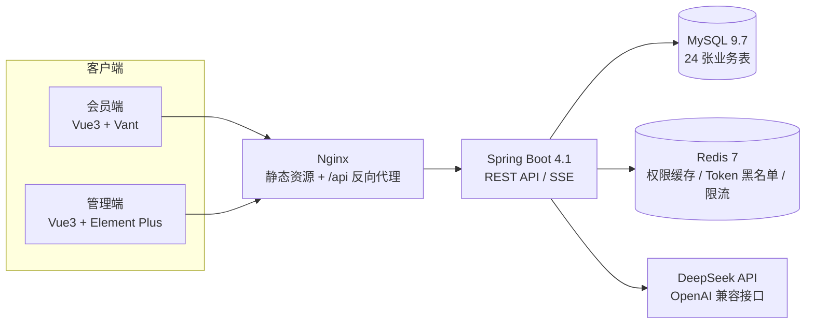

# AI 智能养老社区管理系统

<p align="center">
  基于 <b>Spring Boot 4 + Vue 3</b> 的前后端分离养老社区管理平台<br/>
  覆盖会员、健康档案、健康评测、体检预约、社区活动、积分、消息与 RBAC 权限的完整业务闭环<br/>
  并接入 <b>Spring AI + DeepSeek</b>，实现流式健康咨询、AI 评测与 Function Calling 辅助预约
</p>

<p align="center">
  
  
  
  
  
  
  
</p>

<p align="center">
  <a href="https://github.com/zhaofuchen99/eldercare-system/stargazers">
    
  </a>
</p>

---

## 📖 项目简介

这是一个面向**智慧养老社区**的前后端分离业务系统，包含**会员端**与**管理端**两个独立前端：

- **会员端**：面向社区老人及家属，提供健康数据记录、健康评测、体检预约、AI 健康助手、活动报名、积分与消息等日常服务。
- **管理端**：面向社区运营人员，提供会员管理、健康档案、评测问卷、体检套餐与时段、活动、消息推送、RBAC 权限与系统配置等运营能力。

项目不仅实现了常规 CRUD，还重点处理了**并发预约不超卖、积分 FIFO 账务、双 Token 无状态认证、动态 RBAC 权限、SSE 流式 AI 对话与工具调用**等具有工程复杂度的场景，并配套 Docker Compose 一键部署、接口文档、部署文档与冒烟测试脚本。

> 设计规模：后端约 **190 个 Java 文件 / 22 个 Controller / 24 张业务表**，两个前端共 **30+ 页面**。

## ✨ 功能概览

### 会员端（移动端风格）

| 模块 | 能力 |
| --- | --- |
| 账号体系 | 手机号注册、短信验证码登录、密码找回、修改密码 |
| 健康档案 | 录入血压 / 血糖 / 心率 / BMI 等指标，查看历史记录与趋势 |
| 健康评测 | 问卷答题、规则评分、AI 建议、评测历史与报告 |
| 体检预约 | 浏览套餐、选择时段、积分支付、取消预约、下载体检报告 |
| AI 健康助手 | 多会话管理、SSE 流式对话、个性化健康上下文、对话式预约 |
| 社区活动 | 活动列表 / 详情、在线报名、签到 |
| 积分中心 | 积分余额、明细流水、FIFO 消费与过期规则 |
| 消息中心 | 未读统计、消息列表 / 详情、标记已读 |
| 个人中心 | 资料维护、会员等级、密码管理 |

### 管理端（PC 后台）

| 模块 | 能力 |
| --- | --- |
| 数据工作台 | 会员、预约、活动、评测等核心指标看板（ECharts） |
| 会员管理 | 分页查询、详情、启用 / 禁用、等级调整、积分调整、重置密码 |
| 健康档案 | 会员健康记录与趋势查询 |
| 评测管理 | 问卷增删改查、题目批量维护、发布 / 下架 |
| 体检管理 | 套餐维护、时段批量生成、预约处理、体检报告上传 |
| 活动管理 | 活动发布、编辑、删除、报名列表与签到统计 |
| 消息管理 | 单条推送、批量推送、消息查询与删除 |
| 系统配置 | AI 系统提示词等配置项在线维护 |
| RBAC | 角色、权限、资源管理，角色授权、菜单与按钮级权限 |

## 🛠️ 技术栈

| 分类 | 技术 |
| --- | --- |
| 后端框架 | Java 25、Spring Boot 4.1、Spring Security 7.1 |
| 持久层 | MyBatis 4.1、PageHelper、MySQL 9.7 |
| 缓存 / 会话 | Redis 7（权限缓存、Token 黑名单、短信限流） |
| 认证授权 | JWT（jjwt 0.13）、Access Token + Refresh Token、BCrypt、RBAC |
| AI 能力 | Spring AI 2.0、DeepSeek（OpenAI 兼容接口）、SSE、Function Calling |
| 会员端 | Vue 3.5、Vite 8、Vant 4、Pinia 4、Vue Router 5、Axios |
| 管理端 | Vue 3.5、Vite 8、Element Plus 2.14、ECharts 6、Pinia、Axios |
| 部署运维 | Docker / Docker Compose、Nginx、多阶段镜像构建 |

## 🏗️ 系统架构



生产编排中，MySQL、Redis、后端仅运行在 Docker 内网，不对外暴露端口；浏览器只访问 Nginx 托管的会员端（80）与管理端（8081）。

## 🔥 技术亮点

### 1. 双 Token 无状态认证与动态 RBAC

- **Access Token（2h）+ Refresh Token（7d）** 双 Token 机制，Refresh Token 持久化到数据库，支持刷新与撤销。
- 登出时将 Access Token 写入 **Redis 黑名单**，TTL 与 Token 剩余有效期一致，避免“登出后旧 Token 仍可用”。
- 密码采用 **BCrypt** 存储；短信验证码 5 分钟有效，并按 **同手机号 3 次/分钟、10 次/天** 限流。
- RBAC 采用 `user_role → role_permission → permission_resource` 三级模型，权限码同时驱动**接口鉴权、侧边菜单与按钮显隐**。
- 角色权限和资源 ID 使用 Redis 缓存，权限变更时精确失效；Spring Security 同时启用**路径级**与**方法级**鉴权。

### 2. 高并发预约与报名控制

- 体检时段名额通过 **MySQL 条件原子 UPDATE** 扣减：

  ```sql
  UPDATE appointment_slot
  SET current_count = current_count + 1,
      status = IF(current_count + 1 >= max_count, 'FULL', status)
  WHERE id = ? AND deleted = 0 AND current_count < max_count;
  ```

  仅当 `current_count < max_count` 时才更新成功，从数据库层杜绝超卖，无需分布式锁。
- 预约、取消、积分扣减在同一事务内完成，失败整体回滚；取消预约时原子归还名额并退回积分。
- 活动报名与签到同样采用条件更新保证状态流转的一致性，冒烟测试脚本内置并发预约场景校验。

### 3. 批次化积分账务（FIFO）

- 积分采用**获得批次 + FIFO 消费**模型：每笔获得积分生成一条有效期 1 年的批次流水。
- 消费时按“最早获得且未过期”的批次逐笔扣减，并记录消费明细，保证账实一致、可追溯。
- 扣减前使用 `FOR UPDATE` 行锁防止并发双扣；定时任务每日清理过期未消费批次。
- 预约取消时按原批次加回积分，并补一条展示型退款流水，避免重复计余额。

### 4. Spring AI + DeepSeek 的工程化落地

- 基于 Spring AI 的 `ChatClient` 接入 DeepSeek（OpenAI 兼容接口），支持**非流式**与**SSE 流式**两种对话方式。
- 流式响应逐字推送；客户端断开、超时或异常时仍会持久化消息并标记状态，**不丢对话记录**。
- 默认携带最近 **10 轮（20 条）** 上下文；系统提示词支持通过管理端配置项动态维护。
- **个性化健康上下文**：`HealthContextBuilder` 聚合用户档案、最新健康指标、近 6 月趋势、最近评测与体检记录，脱敏后注入 Prompt。
- **Function Calling**：AI 可调用 `queryPackages`、`querySlots`、`bookAppointment` 等工具，直接完成“查套餐 → 选时段 → 预约”的对话式操作；预约会扣积分，因此系统提示词强制要求**用户明确确认后**才可调用。
- 未配置 API Key 时应用仍可正常启动，AI 消息降级标记为 `FAILED`，不影响其他业务。

### 5. 其他工程实践

- **SSE 异步分派的 Security 兼容**：为 `DispatcherType.ASYNC` 单独配置安全链，解决流式响应结束/超时时被误判为匿名请求而 403 的问题。
- **体检报告**：仅允许 PDF、最大 20MB，按月分目录存储到持久化卷；下载链接带签名参数，避免直接暴露文件路径。
- **定时任务**：积分过期清理、AI 消息清理、预约归档、体检/活动提醒、过期验证码清理。
- **统一响应与异常处理**：`Result<T>` 统一返回结构，业务异常与参数校验异常集中处理。
- **容器化部署**：后端、会员端、管理端均为多阶段构建镜像，MySQL / Redis 带健康检查，启动顺序由依赖关系保证。

## 📁 项目结构

```text
eldercare-system/
├── src/main/java/com/zfc/eldercare/
│   ├── api/controller/          # 22 个 REST Controller（会员端 / 管理端）
│   └── core/
│       ├── service/             # 业务服务与实现（AI、预约、积分、RBAC 等）
│       ├── mapper/              # MyBatis Mapper 接口
│       ├── entity/ dto/ vo/     # 数据模型
│       ├── security/ filter/    # JWT 过滤器与 Security 处理器
│       ├── tool/                # AI Function Calling 工具
│       ├── scheduler/           # 定时任务
│       └── config/              # Security / Redis / MyBatis / CORS / Spring AI
├── src/main/resources/
│   ├── application.yaml         # 应用配置
│   └── mapper/                  # MyBatis XML（24 组）
├── web-member/                  # 会员端（Vue3 + Vant）
├── web-admin/                   # 管理端（Vue3 + Element Plus）
├── sql/
│   ├── init.sql                 # 建库 + 24 张表 + 初始数据 + RBAC 种子
│   └── give-test-points.sql     # 测试积分发放脚本
├── docs/
│   ├── 接口文档.md               # 完整 REST / SSE 接口说明
│   ├── 部署文档.md               # Docker 部署、HTTPS、备份与运维
│   └── 验收自测清单.md            # 功能与安全验收项
├── scripts/smoke-test.sh        # 冒烟测试（核心流程 / 安全 / 边界 / 并发）
├── Dockerfile                   # 后端多阶段构建
├── docker-compose.yml           # 一键编排 MySQL、Redis、后端、双前端
└── README.md
```

## 🚀 快速开始

### 方式一：Docker Compose 一键部署（推荐）

**环境要求**：Linux 服务器或本机安装 Docker 与 Docker Compose（建议 ≥ 4GB 内存）。

```bash
# 1. 克隆仓库
git clone https://github.com/zhaofuchen99/eldercare-system.git
cd eldercare-system

# 2. 准备环境变量（必做）
cp .env.example .env
vi .env    # 至少修改 MYSQL_ROOT_PASSWORD、JWT_SECRET、REPORT_DOWNLOAD_SECRET

# 3. 构建并启动（首次拉镜像 + 编译约 10~30 分钟）
docker compose up -d --build

# 4. 查看状态（全部 healthy 且无重启为正常）
docker compose ps
docker logs -f eldercare-backend
```

启动完成后访问：

| 入口 | 地址 | 说明 |
| --- | --- | --- |
| 会员端 | `http://服务器IP/`（默认 80） | 手机 / PC 浏览器访问 |
| 管理端 | `http://服务器IP:8081/` | 管理后台 |
| 后端 API | `http://服务器IP/api/...` | 经 Nginx 代理，不直接暴露 8080 |

> MySQL 首次启动会自动执行 `sql/init.sql`，完成建库、建表、初始数据与 RBAC 种子导入。

### 方式二：本地开发

**环境要求**：JDK 25、Maven 3.9+、Node.js ≥ 20.19、MySQL 8.0+/9.x、Redis 7。

```bash
# 1. 初始化数据库（脚本内含 CREATE DATABASE eldercare）
mysql -uroot -p < sql/init.sql

# 2. 启动 Redis（application.yaml 本地默认端口为 6380，可用环境变量覆盖）
redis-server --port 6380

# 3. 启动后端（默认 8080）
export DB_PASSWORD=你的数据库密码
export DEEPSEEK_API_KEY=sk-你的key      # 可选；不填则 AI 功能降级
./mvnw spring-boot:run

# 4. 启动会员端（5173，/api 自动代理到 8080）
cd web-member && npm install && npm run dev

# 5. 启动管理端（5174）
cd web-admin && npm install && npm run dev
```

若本地 Redis 使用默认 6379 端口，启动后端前设置：

```bash
export SPRING_DATA_REDIS_PORT=6379
```

### 默认演示账号

| 端 | 手机号 | 密码 |
| --- | --- | --- |
| 管理端 | `13800000000` | `Admin@123456` |
| 会员端 | `13800138000` | `Test@123456` |

> 以上账号由 `sql/init.sql` 初始化，仅用于演示。部署到公网前请务必修改密码与所有密钥。
> 短信为**本地模拟实现**：验证码与通知会打印到后端日志，接入真实短信服务商后替换 `SmsService` 实现即可。

## 📡 接口与文档

- 完整接口说明见 [docs/接口文档.md](docs/接口文档.md)，涵盖认证、健康、评测、AI、预约、活动、消息、积分、会员、配置与 RBAC 等模块。
- 所有接口统一返回：

  ```json
  {
    "code": 200,
    "message": "success",
    "data": {}
  }
  ```

- 列表接口统一分页参数 `page` / `size`，返回 `total`、`page`、`size`、`list`。
- AI 流式对话接口使用 `text/event-stream`（SSE）。

## 🧪 测试与验证

```bash
# 后端冒烟测试（需后端已启动；依赖 curl、jq；并发/注册场景需 python3 + pymysql）
BASE_URL=http://localhost:8080 ./scripts/smoke-test.sh
```

脚本覆盖：

- 核心流程：登录、健康数据、AI 咨询、体检预约、活动报名
- 安全场景：未登录返回 401、越权访问返回 403
- 边界场景：积分不足、名额已满、错误验证码
- 并发场景：同一时段多用户预约，验证不超卖

完整人工验收项见 [docs/验收自测清单.md](docs/验收自测清单.md)。

## ⚙️ 环境变量

| 变量 | 必填 | 说明 |
| --- | --- | --- |
| `MYSQL_ROOT_PASSWORD` | ✅ | MySQL root 密码，部署前务必修改 |
| `JWT_SECRET` | ✅ | JWT 签名密钥，建议 ≥ 32 位随机字符串 |
| `REPORT_DOWNLOAD_SECRET` | ✅ | 体检报告下载链接签名密钥 |
| `DEEPSEEK_API_KEY` | ❌ | DeepSeek API Key；不填则 AI 功能降级 |
| `MYSQL_IMAGE` | ❌ | MySQL 镜像，默认 `mysql:9.7` |
| `MEMBER_PORT` | ❌ | 会员端对外端口，默认 `80` |
| `ADMIN_PORT` | ❌ | 管理端对外端口，默认 `8081` |

更多部署、HTTPS、数据备份与运维说明见 [docs/部署文档.md](docs/部署文档.md)。

## 📌 说明

- 生产环境请启用 **HTTPS**，并且只对外开放会员端与管理端端口，不要暴露 `3306`、`6379`、`8080`。
- AI 健康分析结果仅用于项目演示与技术研究，**不构成医疗诊断或治疗建议**。
- 本项目为个人学习与课程设计项目，仅供学习交流使用。
